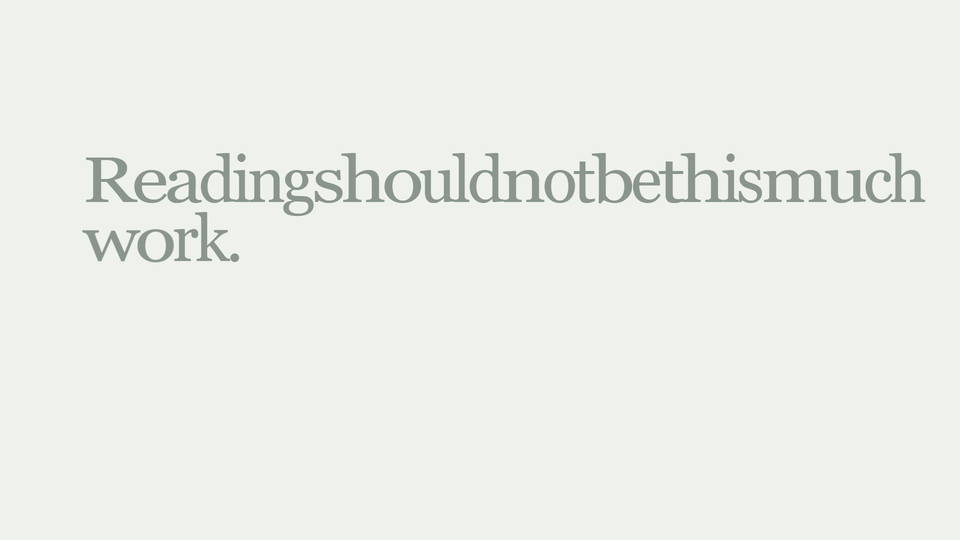
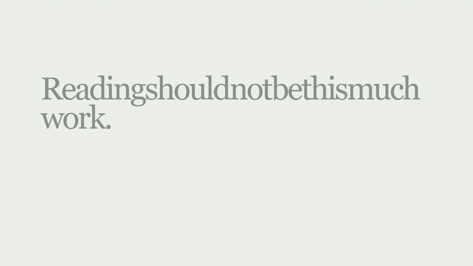
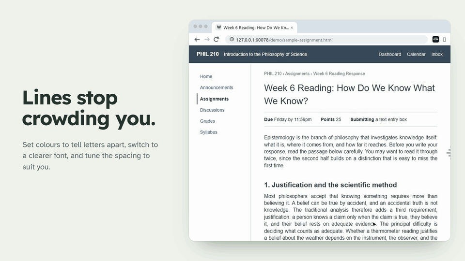
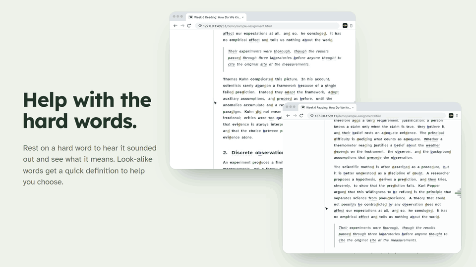
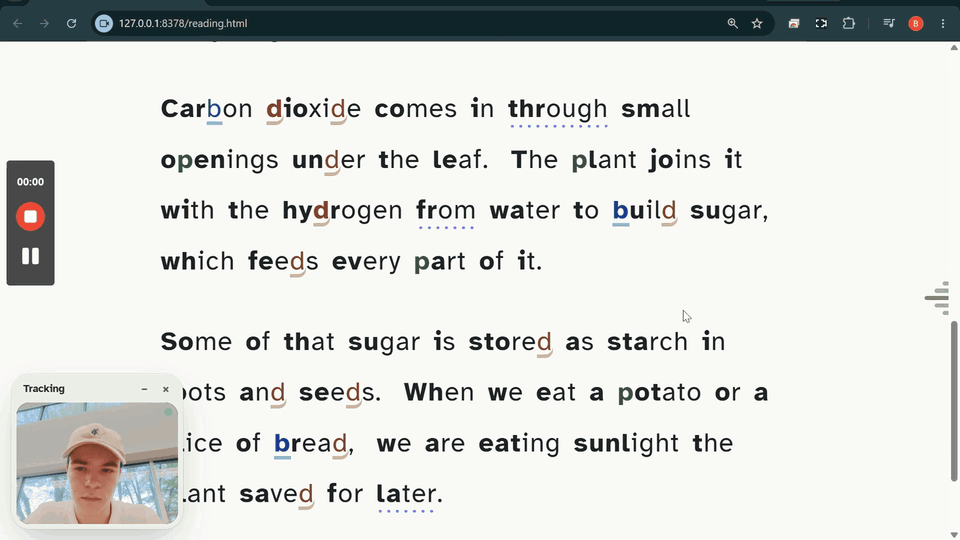

<div align="center">



# Glider

**A Chrome extension that reshapes any web page to suit how you read, and steps in when you get stuck.**

Made with dyslexia in mind. Runs on your device. No accounts, no build step.

[Showcase](#showcase) · [Install](#install) · [Features](#features) · [Privacy](#privacy) · [Development](#development) · [Known limits](#known-limits)

</div>

---

## Showcase

### The 30-second tour



A cut of the real extension at work, from opening the panel to the word lens. Watch it in full quality as [`glider-reel.mp4`](docs/showcase/glider-reel.mp4) (1920×1080, no sound).

### The presentation

Every clip below is a **live screen recording of the real extension** on the sample course page in [`demo/sample-assignment.html`](demo/sample-assignment.html). These are the slides from our presentation. You can download the full deck as [`Glider-showcase-gif.pptx`](showcase/Glider-showcase-gif.pptx): five slides that advance on click, with each clip looping until you move on.

<table>
<tr>
<td width="50%" valign="top">

### 1 · Lines stop crowding you



Open Glider from the mark on the side of the screen, and one switch adds space between letters, words and lines and bolds the start of every word. Then colour the letters people mix up most (b, d, p and q), switch to the Atkinson Hyperlegible font, and set size and spacing to suit you.

</td>
<td width="50%" valign="top">

### 2 · Help with the hard words



Rest on a word. Glider rates how hard it is to read (**Easy**, **Medium** or **Hard**), shows its **CEFR** level, splits it into chunks you can hear, sounds it out and gives its meaning. Look-alike words such as *affect* and *effect* come with a quick meaning for each.

</td>
</tr>
<tr>
<td width="50%" valign="top">

### 3 · It sees you stuck



With eye tracking on, Glider learns your normal reading pace through the webcam. When a passage slows you down, it offers that paragraph again in plainer words, right where you are and with the same meaning. The camera is processed on your device and no video is stored.

<sub>In this clip, the left-to-right gaze comes from the webcam; which line the dot is on is staged.</sub>

</td>
<td width="50%" valign="top">

### Glider doesn't change what you learn. It clears the way to it.


</td>
</tr>
</table>

---

## Contents

- [Install](#install)
  - [Try eye tracking on another computer](#try-eye-tracking-on-another-computer)
- [Features](#features)
  - [The reading lens](#the-reading-lens)
  - [Word help](#word-help)
  - [The dock and settings](#the-dock-and-settings)
  - [Eye tracking](#eye-tracking-optional-off-by-default)
  - [Simplify hard text](#simplify-hard-text-on-a-struggle)
  - [Reading Check](#reading-check-analytics-dashboard)
- [Privacy](#privacy)
- [Development](#development)
- [Known limits](#known-limits)
- [Credits and licences](#credits-and-licences)

---

## Install

Glider is a Manifest V3 extension. It isn't on the Chrome Web Store yet, so you load it unpacked:

1. Open `chrome://extensions` (or `edge://extensions` or `brave://extensions`).
2. Turn on **Developer mode** (top right).
3. Click **Load unpacked** and choose the `glider-extension` folder. If an older copy is already loaded, press its reload arrow instead.
4. Pin Glider from the puzzle-piece menu.
5. Open any article. The lens is already on, and the Glider mark sits on the edge of the screen. Tabs that were already open work straight away; if one doesn't, reload it.

> [!TIP]
> To try it on a local file such as `demo/sample-assignment.html`, also switch on **Allow access to file URLs** on the extension's details page.

### Try eye tracking on another computer

Eye tracking is the **Adaptive** switch in the panel and the popup. To measure how well it works on a given computer and camera, use the Gaze Lab, a local page that runs short tasks and saves the results as numbers (no pictures).

You need Git, [Node.js](https://nodejs.org) (LTS or newer) and Chrome. There is nothing to install with npm.

```bash
git clone -b ui/current-look https://github.com/bogdanboyko46/Glider.git
cd Glider
node tests/lab/server.mjs
```

1. Load the `glider-extension` folder as described above. After a `git pull`, press the extension's reload arrow.
2. Leave the server running and open <http://127.0.0.1:8377/> in the same Chrome profile. Allow the camera when asked. A red banner means the extension didn't answer: reload the extension, then the page.
3. Run **camera** first. It reports the frame rate; under about 20 a second, put more light on your face.
4. Run **calibrate** once, then **lines-paced**, **lines-self** and **stall**, sitting as you normally would. In stall, when asked to re-read, read both marked lines, press `R`, and jump back to the first of them.
5. Each run is saved as one JSON file in `tests/lab/recordings/` (not committed). `node tests/lab/analyze.mjs tests/lab/recordings/<file>` prints its figures. To compare computers, copy that folder across.

More on the tasks and the recording format is in [`tests/lab/README.md`](tests/lab/README.md).

---

## Features

| | Feature | In short |
|---|---|---|
| 📖 | [Reading lens](#the-reading-lens) | Spacing, text size, bold word starts and small pauses, all behind one switch |
| 🔤 | [Word help](#word-help) | Chunks and sounds, Hear word, Sound it out, reading difficulty, CEFR level, meaning, word parts and look-alike words |
| ⚙️ | [Dock and settings](#the-dock-and-settings) | A quiet mark on the screen edge; sliders, b d p q colours and the Hyperlegible font |
| 👁️ | [Eye tracking](#eye-tracking-optional-off-by-default) | Learns your reading pace and notices when a line or paragraph slows you down |
| ✨ | [Simplify](#simplify-hard-text-on-a-struggle) | Shows the paragraph you're stuck on in plainer words, with the same meaning |
| 📊 | [Reading Check](#reading-check-analytics-dashboard) | A two-minute read with a dashboard of speed, comprehension and gaze patterns |

There's one reading lens and one switch, and no modes. Switching the lens off puts the page back exactly as it was, with no reload.

### The reading lens

| Part | What happens |
|---|---|
| Spacing guard | Left-aligns text and widens letter spacing, word spacing and line height |
| Text size | Enlarges body text from 100% to 160%; it reflows inside the same column |
| Bionic cadence | Bolds the start of each word (1 letter for short words, 2 for words of 4 to 5 letters, about 40% beyond that) and adds a small pause after commas, semicolons and full stops |

### Word help

| Part | What happens |
|---|---|
| Hover lens | Hover a word of 6 or more letters to see it broken into chunks, each with the sound it makes written underneath (the stressed chunk in bold). Tap a chunk to hear just that sound, **Hear word** for the whole word, or **Sound it out** to hear each chunk in turn, lit up as it's said, then the whole word. Double-click keeps the lens open |
| Reading difficulty | The lens says how hard the word is to **read**: **Easy**, **Medium** or **Hard**, and for Medium and Hard words, why (for example *4 syllables · one part is not said*). It weighs length, how common the word is, spellings that don't match the sound (silent letters, "ough", "ph", a written part that isn't said, as in *vegetable*) and look-alike words |
| CEFR level | A small tag gives the word's level on the **CEFR** scale, the international scale for vocabulary (**A1**, most common, to **C2**, rarest). It says how common the word is, not how hard it is to decode. **Word difficulty** on the Glider page turns the rating and the tag off |
| Meaning | **Meaning** in the lens opens the word's definition (up to two senses, with an example) from WordNet, offline. *Show the meaning straight away* opens it together with the lens. With an Anthropic key saved, **Explain simply** asks Claude what the word means in this sentence, in plain words; only the word and its sentence are sent |
| Word parts | Prefixes, roots and suffixes get a small badge over the chunks they cover (*care* BASE, *ful* SUFFIX, *ly* SUFFIX). When the parts don't line up with the syllables (*per·spec·tive* is per + spect + ive), a **Word parts** row shows them instead. Press a badge to see what the part means (*-ful: full of*); a base word shows its dictionary meaning |
| Look-alike words | Commonly confused words get a dotted underline. Hovering one shows a short meaning for each word in its group (177 groups, 380 words) |

### The dock and settings

**The dock is the logo on the side of the screen.** Five bare strokes sit on the right edge; press them to open the panel and switch the lens on there. When the lens is off, the strokes draw back and turn grey. Drag the mark up or down, or across to the other side.

The panel fine-tunes the lens with four sliders (size 100 to 160%, letters 0 to 4 px, words 0 to 10 px, lines 1.4 to 2.4), colours for b d p q, and the Atkinson Hyperlegible font. The last two are off by default.

| Shortcut | Action |
|---|---|
| `Alt L` | Open or minimise the dock |
| `Esc` | Minimise the dock |

You can change shortcuts at `chrome://extensions/shortcuts`. Settings and the dock position are saved in `chrome.storage.local` and follow you across tabs and reloads.

### Eye tracking (optional, off by default)

Switch on **Eye tracking** in the panel or the popup. The webcam is read inside an extension-origin iframe; only numbers (eye-shape features) leave that frame, and nothing leaves the device. The first time, allow the camera on the page that opens.

Calibration has two parts and takes about a minute:

1. **Eyes.** Follow 18 dots. This fits the gaze model and reports its accuracy.
2. **Reading pace.** Read one short, easy passage at your normal speed and press Space. This sets your **baseline**: words a minute, how much your time per word varies from line to line, and how often you jump back a line.

From the baseline comes **τ (tau)**, your personal threshold: you're treated as struggling when a line takes more than τ times as long as your baseline predicts.

When you struggle, Glider changes only the wording: the paragraph is replaced in place by a [simpler version](#simplify-hard-text-on-a-struggle), with no highlight, popup or prompt, and hard paragraphs further down are simplified before you reach them. Switching the lens or eye tracking off undoes all of it.

<details>
<summary><b>How the baseline, τ and struggle signals are calculated</b></summary>

| Value | How it's set |
|---|---|
| Baseline pace | Gaze dwell per line over the passage; falls back to the wall clock when gaze coverage is poor. Stored for 30 days (`grBaseline`) |
| τ | `1.6 + 1.4 × (cv / 0.6)`, clamped to 1.6 to 3.0, where `cv` is your own line-to-line variability. Steady readers get help sooner; erratic readers aren't flagged for their normal variation. Without a baseline, τ is 2.0 |
| Help slider | Multiplies τ by 1.4, 1.2, 1, 0.85 or 0.7 (Rarely to Often) |
| Working pace | Starts at the baseline and keeps learning from paragraphs read without trouble, but stays within 0.6 to 1.5 times the baseline |

Struggle signals, all relative to the baseline:

- **Stuck line:** time on a line above `max(2 s, τ × expected)`.
- **Rereading:** two jumps back within 15 s (three for habitual re-readers).
- **Slow paragraph:** an unfinished paragraph above `1.1 × τ × expected`.

The state ends when you move to another line at normal pace, change paragraph, or 15 s pass.

The pure maths is in `gaze/gaze-core.js` (`summarizeBaseline`, `tauFromCv`, `struggleDecision`); the tuning constants are there and in `checkStruggle` in `gaze/gaze-reader.js`.

| Shortcut | Action |
|---|---|
| `Alt Shift E` | Eye tracking on or off |
| `Alt Shift C` | Recalibrate |
| `Alt Shift G` | Debug overlay (gaze dot, decoded line, pace, τ and the struggling state) |

</details>

### Simplify hard text (on a struggle)

With eye tracking on, the paragraph you get stuck on is replaced, right where it is, by a simpler version. Nothing else changes: same font, size and spacing, with no label or prompt. After that, hard paragraphs further down are simplified before you reach them. With **See original** switched on in the panel, a small mark at the end of a changed paragraph puts it back; turning eye tracking or the lens off puts everything back.

- **On the device, always.** `simplify/simplifier.js` swaps hard words for common ones, shortens wordy phrases and splits long sentences at safe joints. It appears at once and needs nothing else.
- **Claude, when the rewrite service is set up.** The offline version still appears at once. Claude's rewrite is used only where you cannot see it change: paragraphs further down, or one you have scrolled past. The extension holds no API key: it sends the paragraph to a small server you host ([`proxy/`](proxy/README.md)), which holds the Anthropic key and calls Claude. **Use Claude rewrites** on the Options page (`simplify/options.html`) turns this off.
- The page's own paragraph is never edited. It's hidden, and a stand-in with the same tag and classes sits after it, so the page goes back exactly as it was.

<details>
<summary><b>Where it lives in the code</b></summary>

`simplify/bridge.js` listens for the tracker's `struggle` event; `simplify/claude.js` runs in the service worker and calls the rewrite service, whose address is `DEFAULT_SERVICE_URL` there (or set on the Options page). The model name and prompt live on the server in `proxy/lib/core.js`.

</details>

### Reading Check (analytics dashboard)

Press **Open** next to *Reading check* in the toolbar popup. In about two minutes it calibrates the eye tracker, shows one short passage for the chosen age band, and asks two comprehension questions. Then it opens a dashboard of the read:

- speed and comprehension
- fixations, regressions and line re-reads
- a scanpath replay with a heatmap, and time per line
- a fixation histogram and a five-score reading profile
- fatigue and focus signals: blinks, gaze stability, head movement, and the first half against the second

Findings are written in plain language and link to Glider settings, which **Apply recommended settings** writes for you.

> [!IMPORTANT]
> Reading Check is **not a diagnosis**. A webcam resolves lines, not words, and the typical ranges in `assessment/norms.js` are approximate values from lab eye-tracking studies that haven't been validated for webcams.

<details>
<summary><b>Demo and saved checks</b></summary>

- `assessment/assessment.html?demo=1` shows the full dashboard from a simulated reader, with no camera. `?demo=sparse`, `?demo=noframes` and `?demo=poor` show how it degrades.
- `assessment/assessment.html?last=1` reopens the most recent saved check.
- While eye tracking is on during normal reading, `assessment/session-logger.js` stores one row a minute (blinks, mean fixation, regression rate) for the dashboard's "Over time" chart.

</details>

---

## Privacy

- **Everything runs on the device.** There are no accounts and no analytics.
- **The camera** is read inside an extension-origin frame. Only numbers leave it, no video or images are stored, and **Delete my data** in Reading Check removes the saved numbers.
- **There are two optional network calls, both off unless you set them up:**
  - the paragraph you're stuck on is sent to your own rewrite service (and on to Claude);
  - **Explain simply** sends one word and its sentence to Claude.

---

## Development

No dependencies are needed for the extension itself. The checks need Node 22+ and a local Chrome (Edge for the real-extension run).

<details>
<summary><b>Automated checks</b></summary>

```bash
node tests/e2e.mjs             # 65 behaviour checks on the demo page (headless Chrome)
node tests/live.mjs            # loads the unpacked extension in Edge and runs it on Wikipedia
node tests/shots.mjs           # screenshots of the pill, panel and hover lens
node tests/popup-shots.mjs     # screenshots of the popup
node tests/words.mjs           # word difficulty, word parts and meanings in the lens (headless Chrome)
node tests/levels.test.js      # word level list and lookup (plurals, -ed, -ing)
node tests/difficulty.test.js  # reading difficulty on real words (vegetable, laud, photosynthesis ...)
node tests/wordparts.test.js   # prefix/root/suffix rules and the bundled split list
node tests/worddata.test.js    # definitions and word parts looked up from the bundled lists
node tests/syllables.test.js   # syllable splitter accuracy on 345 words
node tests/gaze-core.test.js   # gaze maths, baseline and tau
node tests/gaze.mjs            # simulated camera: calibration, reading-pace baseline, planted struggles
node tests/bench/gaze-bench.mjs --compare   # gaze accuracy on a synthetic camera against the saved baseline (tests/bench/RESULTS.md)
node tests/bench/bench.test.mjs             # checks of that benchmark and of its synthetic person
node tests/gaze-camera-smoke.mjs            # the real camera path: unpacked extension in headless Edge, the browser's fake camera playing a public-domain portrait (fetched at run time)
node tests/simplify.test.js    # offline text simplifier
node tests/simplify.mjs        # struggle -> simplify bridge in headless Chrome (canned rewrite-service reply)
node tests/proxy.test.mjs      # the rewrite service's request handling, with a fake Anthropic client
node tests/analytics.test.js   # Reading Check metrics on simulated sessions with planted answers
node tests/assessment.mjs      # Reading Check dashboard in headless Chrome (demo and degraded data)
node tests/assessment-live.mjs # the whole Reading Check with a simulated reader and fake camera
```

</details>

<details>
<summary><b>Rebuilding the bundled data</b></summary>

```bash
node tools/make-demo-session.js                       # regenerate assessment/demo-session.json
node tools/make-levels.js <cefrj.csv> <octanove.csv>  # rebuild data/levels.txt from the two CSVs in openlanguageprofiles/olp-en-cefrj
node tools/make-dictionary.js <wordnet dict/>         # rebuild data/dictionary.txt from WordNet 3.1 (wn3.1.dict.tar.gz)
node tools/make-wordparts.js <wordnet dict/>          # rebuild data/wordparts.txt (run after the dictionary)
```

</details>

<details>
<summary><b>Manual test checklist</b></summary>

Use a long Wikipedia article (for example *Epistemology*) or `demo/sample-assignment.html`.

- [ ] The page loads with the lens on: spaced, left-aligned text and bold word starts.
- [ ] Hover a long word: each chunk shows its sound underneath. Tap a chunk, press Hear word, then Sound it out, and listen. Hover a word with a dotted underline (their, affect, principal): the meanings appear.
- [ ] Hover *accumulate*: the lens shows **Medium to read**, *4 syllables · a less common word (B2)*, and a **B2** tag. Press Meaning: *get or gather together*. Hover *carefully*: BASE, SUFFIX, SUFFIX badges; press SUFFIX over *ful*: *full of*. Press the bookmark, then open the Glider page from the dock's grid button: the word is under Your words with its sentence.
- [ ] Flip the lens switch: everything returns exactly as it was. Flip it back.
- [ ] Drag the dock to another position; open it and the panel opens inward from that side.
- [ ] In the panel: move the four sliders (Size enlarges body text without sideways scrolling) and turn on Colour b d p q.
- [ ] Type in a search box or comment field: form fields and code blocks are never altered.
- [ ] Open the toolbar popup: its switches match the dock and change it live.
- [ ] Reload the page and open a second tab: the same settings are applied in both.

</details>

<details>
<summary><b>Design notes</b></summary>

The dock and popup use the Sage design. Nine other designs are still defined in `DOCK_CSS` in `content/content.js`, but there's no picker; `skin` in `DEFAULTS` selects one. The visible name is `APP_NAME` in the same file; internal ids, the folder name and storage keys use the `glider` prefix.

</details>

<details>
<summary><b>The showcase deck</b></summary>

The presentation in [`showcase/`](showcase/) is built from live recordings of the real extension:

- `live-capture.mjs` films the extension on the sample page.
- `live2media.py` adds the browser frame and writes MP4 and GIF files.
- `render_cards.mjs` renders the slide layouts from `cards.html`.
- `build_gif_deck.py` assembles `Glider-showcase-gif.pptx`.
- `gemini_cards.py` asks Gemini for layout variations of the footage slides (`cards-gemini.html`), and `render_variants.mjs` with `preview_variants.py` renders them for review.

The README clips in `docs/showcase/` are the deck's slides at 960 px.

The 30-second tour (`docs/showcase/glider-reel.mp4`, and its GIF) is made by `make_linkedin.py`. It joins the opening scene (`record_mp4.py`) to a live recording from `live-capture.mjs showcase`.

</details>

### Project layout

```text
glider-extension/
  manifest.json
  popup/             toolbar popup: lens switch, dock visibility
  content/
    content.js         orchestrator, Shadow DOM dock, settings and storage sync
    wordLevels.js      CEFR level lookup (shared with the service worker and the tests)
    readingDifficulty.js  Easy / Medium / Hard to read, with reasons
    wordParts.js       the prefix/root/suffix list and the careful splitter (used at build time)
    wordData.js        definition and word-part lookups in the bundled lists
    domEngine.js       safe TreeWalker tokeniser, original-text cache, bionic, b/d/p/q, look-alike marking
    syllableParser.js  rule-based English syllable splitter
    homophones.js      confusion groups with icons and five-word meanings
    content.css        page-side styles for tokens and text size
  gaze/
    gaze-core.js       pure maths: features, ridge model, fixations, line locking, baseline, tau
    gaze-reader.js     calibration, reading-pace baseline, struggle detection, camera widget
    frame.html/js      camera iframe running MediaPipe Face Landmarker (vendor/)
    permission.html    one-time camera permission page
  simplify/          offline simplifier, struggle bridge, Claude rewrite client, options page
  assessment/        Reading Check: calibration, passage, questions and dashboard
  background/
    service-worker.js  shortcut command; answers pronunciation, word level, meaning and word-part lookups;
                       injects into already-open tabs on install
  data/
    pronounce.txt      the sound of each chunk for about 94,700 words, built from the CMU Pronouncing Dictionary
    sounds.txt         for sounds that speech voices misread, a spelling they say correctly
    levels.txt         CEFR level (A1 to C2) of 8,681 words, from CEFR-J and Octanove (see LICENSE-levels.txt)
    dictionary.txt     definitions from WordNet 3.1 (see LICENSE-wordnet.txt)
    wordparts.txt      prefixes, roots and suffixes of about 7,500 words
  fonts/             Lexend, Atkinson Hyperlegible, Instrument Serif, JetBrains Mono (SIL OFL)
proxy/               the optional rewrite service (holds the Anthropic key, calls Claude)
demo/                sample LMS-style assignment page
showcase/            the presentation deck and the scripts that film and build it
docs/showcase/       the 30-second tour and the deck's slides as GIFs, shown in this README
tests/               dependency-free Chrome DevTools Protocol tests
tools/               scripts that rebuild the bundled word data
parked/              the read-aloud engine, its test and the reading ruler, not loaded by the extension
```

---

## Known limits

- Text inside cross-origin iframes (some LMS quiz tools and embedded readers) and inside other components' closed shadow roots isn't reached.
- On heavily scripted pages that rewrite their own text constantly, a rewritten line can lag until it next re-renders.
- The hover lens works with a pointer only, for now.
- Sounds are shown for words in the bundled list (American English). Words not in it still get their chunks and Hear word.
- Speech uses the browser's built-in voice. The spelling fed to the voice for each sound was checked against two Windows voices (David and Zira): about 94% of sounds are said exactly, 2% closely and 4% are best effort. Other voices (Mac, Chromebook, online voices) haven't been checked.
- Text size enlarges paragraphs, list items, quotes and captions. Headings, tables and site menus keep their own size.
- Browser pages (`chrome://`), the Chrome Web Store and the built-in PDF viewer don't allow extensions to run.

---

## Credits and licences

- **Glider** is released under the [MIT License](LICENSE).
- **Word levels:** CEFR-J Wordlist and Octanove C1/C2 vocabulary (CC BY-SA 4.0). See `glider-extension/data/LICENSE-levels.txt`.
- **Definitions:** Princeton WordNet 3.1. See `glider-extension/data/LICENSE-wordnet.txt`.
- **Pronunciations:** built from the CMU Pronouncing Dictionary.
- **Face landmarks:** MediaPipe Face Landmarker.
- **Fonts:** Lexend, Atkinson Hyperlegible, Instrument Serif and JetBrains Mono, all under the SIL Open Font License.
